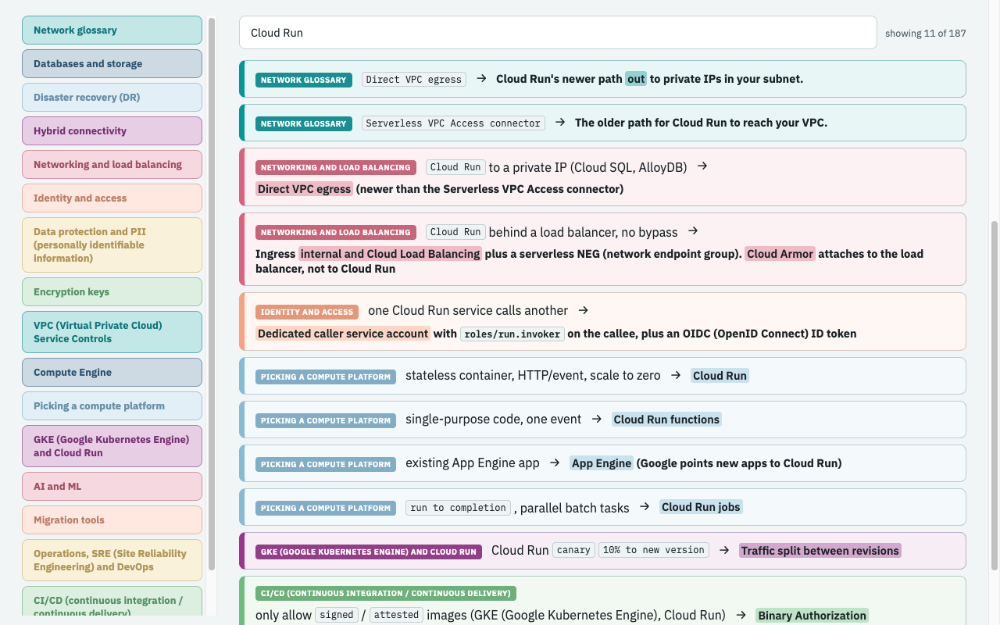
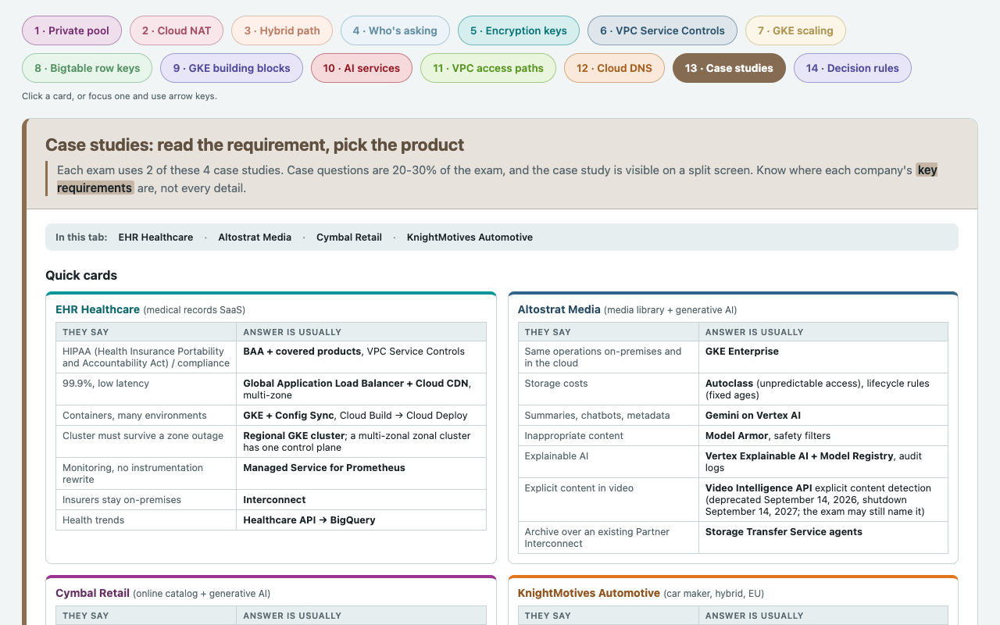

# PCA study app

This is an offline version of the study aid for the Google Cloud Professional Cloud Architect exam. 
I built this based off my own notes from taking a bunch of mock exams and exploring exam topics that peaked my interest.
The guide as the following:
- concept diagrams (private pools, Cloud NAT, hybrid paths, VPC Service Controls, GKE scaling and others)
- decision tables that turn a requirement in a question into a product choice
- quick cards for the four exam case studies:
  - EHR Healthcare, Altostrat Media, Cymbal Retail and KnightMotives Automotive





- [Live version](https://davidrusho.com/tools/pca-study/)
- [Write-up](https://davidrusho.com/posts/pca-study-app/)

## Run it

Open `index.html` in a browser. 
The page is static, so there's no build step or no server to run. 

## Edit the keywords

To setup your own edit to the keywords section: 
Edit `data/keywords.md`, then run:

```bash
python3 build_keywords.py
```

This should rewrite `keywords.js`. 
The script reads each markdown table under a `## ` heading, plus the bullets under "Habits that find the answer". It uses only the Python standard library.

## Tests

```
python3 test_build_keywords.py
```

## Disclaimer

These are my personal study notes. They are not affiliated with or endorsed by Google, and they contain no real exam questions. Where I quote Google Cloud documentation, the quote is attributed and linked to the page it came from. Google Cloud documentation content is licensed under CC BY 4.0. Check the current documentation before relying on anything here, since products change.

## Licence

The code is MIT licensed, see `LICENSE`. The IBM Plex fonts in `fonts/` are licensed under the SIL Open Font License 1.1, see `fonts/OFL.txt`.
